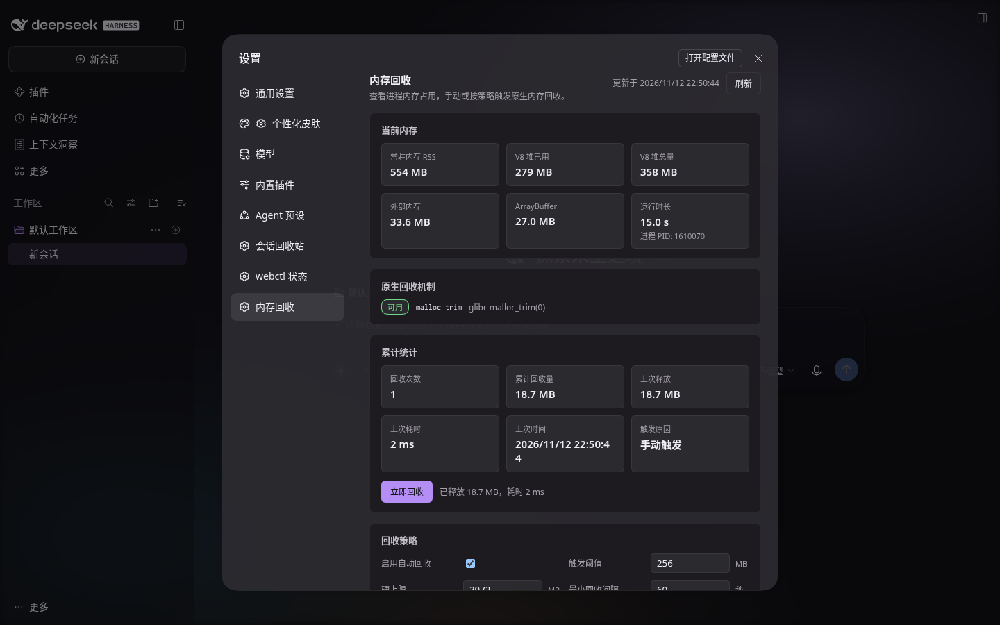

# dsh-lowmem

**降低 DeepSeek Harness 宿主的常驻内存占用。**

DSH 跑久了 RSS 会一路涨（实测连续运行 10.7 小时后 1.8–2.7 GiB）。很多人第一反应是"内存泄漏了"，
但实测下来**不是**——真正的原因是**原生分配器的碎片**，而 V8 堆只占其中一小块。

| 手段 | 实测收益 | 代价 |
|---|---|---|
| 强制 GC（`--expose-gc`） | **仅 9.3 MiB** | major 140 ms / major-snapshot **10.7 s** 且把 RSS 顶高 777 MB |
| `malloc_trim(0)`（glibc） | **925 MB** | **19 ms** |
| koffi 在宿主进程内调 `malloc_trim(0)` | **168 MB**（当时可回收的部分） | **19 ms**，无需重启 |

所以本插件做的第一件事不是"清 GC"，而是**把碎片还给操作系统**。

---

## 核心结论（都是本机实测，DSH 0.2.2-rc.1 / Linux x64 / Node 24.21.0）

宿主的内存画像：

| 指标 | 实测值 |
|---|---|
| `VmRSS` | 1.81 GiB（空闲）～ 2.67 GiB（繁忙） |
| V8 `heapUsed` | 517–760 MB |
| glibc `[heap]` | 889–909 MB |
| 匿名映射数 | 3270 个（含大量 64 MiB 粒度的 arena 映射） |

三个决定性实验：

1. **强制 GC 只回收 9.3 MiB** → V8 堆不是问题，GC 不是杠杆。
2. **gdb 在宿主里调 `malloc_trim(0)`：RSS 2493 → 1568 MB，瞬时回收 925 MB**
   → 根因是 glibc malloc arena 碎片（16 核 / 12 线程 → 多个 arena 反复申请释放大块页面后留下空隙）。
3. **宿主进程内用 koffi 调同一函数：RSS 1730 → 1562 MB，19 ms，无需重启**
   → 可以用普通 npm 依赖在进程内完成，**不需要编译任何原生代码**。

另外，官方插件**完全没有**内存管理：全量 grep `global.gc` / `--expose-gc` / `malloc_trim` /
`forceGarbageCollection` 在 `@deepseek-ai/*/lib` 下 **0 命中**。

---

## 它做什么

### L1 · 原生分配器回收（核心）

定时在合适的时机把碎片还给操作系统。全部经 **koffi FFI** 调用，**零编译**：

| 平台 | 机制 | 备注 |
|---|---|---|
| Linux (glibc) | `malloc_trim(0)` | 实测 19 ms / 925 MB |
| Linux (musl) | 不支持（无 `malloc_trim`） | 自动降级并在设置页说明 |
| macOS | `malloc_zone_pressure_relief(malloc_default_zone(), 0)` | |
| Windows | `EmptyWorkingSet(GetCurrentProcess())` | 会把页换出到页面文件，之后访问会变慢，因此**可单独关闭** |
| 其它 | 不做 L1 | 只做 L2 + 观测 |

**触发策略**（先命中先执行）：

- `hard-cap`：RSS 超过硬上限（默认 3 GiB）→ 立即回收，不管忙不忙；
- `threshold`：相对上次回收后增长超过阈值（默认 256 MiB）→ 且当前无会话在跑 → 回收；
- `idle`：空闲超过兜底间隔（默认 5 分钟）→ 回收；
- 另有 `minIntervalMs`（默认 60 秒）兜底，防止高频反复回收。

### L2 · 配置层收紧

插件自带的 `cordis.patch.yml` 会覆盖几个官方行，把"按条数不按字节"的保留上限调小：

| 行 | 旋钮 | 原值 | 新值 |
|---|---|---|---|
| `ui-trajectory` | `maxResultsPerSession` | 1000 | 200 | 实测该行在活体宿主里就占 **54.68 MiB** |
| `ptc-runtime` | `maxOutputBytes` | 64 MiB / worker | 8 MiB | 该缓冲**跨 run 不清** |
| `jobs` | `settledRetainBytes` 等 | schema 默认 | 显式声明 | settled 记录**条数无界** |
| `session-projection-cache` | `writeEveryEvents` / `writeIntervalMs` | 200 / 5000 | 50 / 2000 | 缩短内存里的 dirty 窗口 |
| `typert-gateway` | `streamInboxBytes` | 262144 | 262144 | 显式声明防上游漂移 |
| `spill-policy` | `maxInlineTokens` | 12500 | 12500 | 显式声明防上游漂移 |

> **刻意不动 `connection.maxRequestBodyBytes`**（默认 300 MiB）。
> 源码注释写明那是为"默认 200 MiB 图片总量经 base64 膨胀后的包络"预留的，压下去会直接打断大图/附件上传。

### L3 · 观测

设置页里能看到：当前 RSS / V8 heapUsed / heapTotal / external、原生机制是否可用、
累计回收次数与总量、上次回收的释放量与耗时，并可手动点"立即回收"。



---

## 安装

```bash
dsh plugin --profile web add dsh-lowmem
# 本机开发：
dsh plugin --profile web add /path/to/dsh-lowmem
```

装完 `dsh.profile.bundles` 会自动对齐。**重启 DSH 后生效。**

> `--profile` 必须写在转发给 pnpm 的参数**之前**；相对路径锚定在**你调用命令的目录**。
> 不要手写 profile 的 `package.json` / `cordis.patch.yml`，也不要在 profile 目录里跑 pnpm。

---

## 设置

宿主半边的配置写在 `~/.dsh/dsh-lowmem/settings.json`（设置页改的就是它）：

| 键 | 默认值 | 含义 |
|---|---|---|
| `enabled` | `true` | 是否启用自动回收 |
| `thresholdBytes` | 268435456（256 MiB） | 相对上次回收后增长多少才回收 |
| `minIntervalMs` | 60000 | 两次回收的最小间隔 |
| `idleIntervalMs` | 300000 | 空闲多久兜底回收 |
| `hardCapBytes` | 3221225472（3 GiB） | 超过就立即回收 |
| `sampleIntervalMs` | 15000 | 采样周期 |
| `gcEnabled` | `false` | 顺带做一次 V8 GC（minor / major） |
| `gcMode` | `minor` | GC 类型；**不要用 major-snapshot**（实测 10.7 s 且顶高 RSS） |

---

## 跨平台

| 目标 | 覆盖方式 |
|---|---|
| Windows x64 / arm64 | koffi 预编译二进制（`@koromix/koffi-win32-*`） |
| Linux x64 / arm64 | koffi 预编译二进制（`@koromix/koffi-linux-*`） |
| macOS x64 / arm64 | koffi 预编译二进制（`@koromix/koffi-darwin-*`） |

koffi 已被 7 个官方 DSH 包依赖（`dsh-fs-local`、`dsh-session-persistence-jsonl`、`dsh-subprocess-local`、
`dsh-win32-process`、`dsh-host-directory-picker-native`、`dsh-sandbox-windows-acl`、`libreoffice-kit`），
宿主自身已经加载了 `koffi.node`，**不会多背一份原生依赖**。

**构建零编译**：安装插件不需要 node-gyp / Rust 工具链；CI 只跑 `node --test`。

---

## 不做什么（以及为什么）

| 不做 | 原因 |
|---|---|
| 驱逐会话的内存状态 | 0.2.2-rc.1 的 `ctx.sessions` **没有** evict / dispose 公开 API |
| 注销 MCP 工具 | `ctx.tools` **没有** unregister |
| 运行时截断工具结果 | 会改写用户会话数据（需要单独的可回退设计），列入二期 |
| WS 下行背压 / SSE 背压 / peers 剪枝 | 官方没有对应旋钮，需要自己补 |
| 动 `connection.maxRequestBodyBytes` | 会打断大图/附件上传 |

---

## 开发

```bash
npm install
node --test 'tests/*.test.mjs'     # 单元测试
node scripts/build-client.mjs      # 生成 client.js（生成物，提交在仓库里）
node scripts/build-client.mjs --check
node scripts/selftest.mjs          # 起一个临时 DSH 实例，验证真实回收效果
```

内部契约见 [`docs/CONTRACT.md`](docs/CONTRACT.md)。

---

## 许可证

MIT
